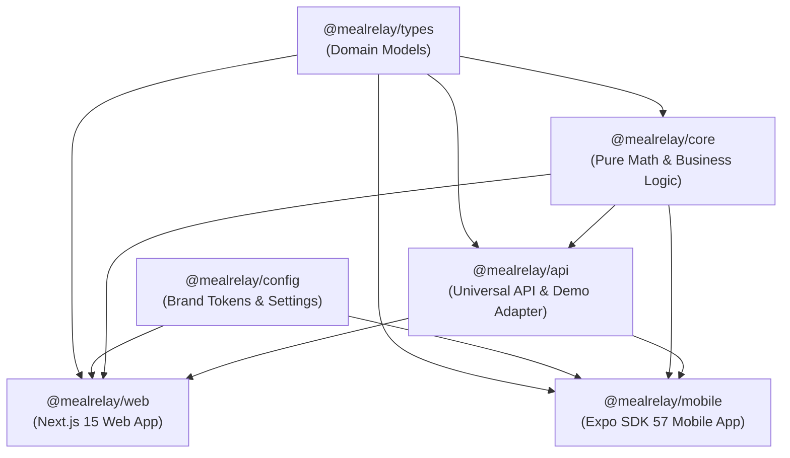

# 🥗 MealRelay — Frontend Monorepo

> **Predict Tomorrow. Prepare Smarter. Waste Less.**  
> Next-generation demand forecasting and preparation planning ecosystem for institutional dining and hostel kitchens.

---

## 📌 Table of Contents

- [Overview & Mission](#-overview--mission)
- [Monorepo Architecture](#-monorepo-architecture)
- [Technology Stack & Exact Versions](#-technology-stack--exact-versions)
- [Packages & Workspaces](#-packages--workspaces)
- [Core Application Screens & Capabilities](#-core-application-screens--capabilities)
- [Design Tokens & Interaction Standards](#-design-tokens--interaction-standards)
- [Developer Quick Start](#-developer-quick-start)
- [Available Scripts](#-available-scripts)
- [Database & Supabase Integration (Optional)](#-database--supabase-integration-optional)
- [Critical Developer Notices & Troubleshooting](#-critical-developer-notices--troubleshooting)

---

## 🎯 Overview & Mission

MealRelay solves one of institutional dining's most persistent challenges: **preventing avoidable food surplus before the first ingredient hits the pan**. 

By analyzing past meal consumption records, headcount, day-of-week trends, and kitchen safety buffers, MealRelay computes intelligent next-day preparation targets. Kitchen managers retain complete operational control to review, fine-tune, and approve recommendations before service.

- **Primary SDG:** **12 — Responsible Consumption and Production**
- **Supporting SDGs:** **2 — Zero Hunger**, **13 — Climate Action**
- **Target Audience:** Mess supervisors, head chefs, and hostel kitchen managers.

---

## 🏗️ Monorepo Architecture

MealRelay utilizes an npm-workspaces monorepo dividing the codebase into dedicated applications (`apps/*`) and shared framework-agnostic libraries (`packages/*`):

```text
frontend/
├── apps/
│   ├── web/                     # Next.js 15 App Router web platform
│   └── mobile/                  # React Native & Expo SDK 57 mobile platform
├── packages/
│   ├── core/                    # Pure portion math, buffer models & forecasting heuristics
│   ├── types/                   # Shared TypeScript domain contracts & schemas
│   ├── config/                  # Brand design tokens, palettes & system settings
│   └── api/                     # Universal API client, demo in-memory adapter & SQL schema
├── package.json                 # Monorepo root configuration & unified scripts
└── README.md                    # Monorepo architectural documentation
```

### Monorepo Dependency Flow



---

## 💻 Technology Stack & Exact Versions

### 1. Web Application (`apps/web`)

| Package / Tool | Version | Role & Description |
| :--- | :--- | :--- |
| **`next`** | `^15.0.3` | React Framework with App Router, Turbopack, and hybrid server/client execution. |
| **`react` & `react-dom`** | `19.2.3` | React 19 core runtime with modern hooks and transitions. |
| **`tailwindcss`** | `^3.4.3` | Utility-first styling engine with custom brand palette extensions. |
| **`motion`** | `^14.3.0` | Production animation library (formerly Framer Motion) for luxury easing curves. |
| **`lucide-react`** | `^0.378.0` | Comprehensive iconography system across all dashboards and navigation. |
| **`d3-scale`** | `^4.0.2` | Data scaling algorithms for precision forecasting and trend visualizations. |
| **`d3-shape`** | `^3.2.0` | Path and area generators for smooth consumption and analytics charts. |
| **`clsx`** | `^2.1.1` | Conditional class name construction. |
| **`tailwind-merge`** | `^2.5.4` | Conflict-free utility class merging. |
| **`postcss`** | `^8.4.38` | CSS transformation pipeline. |
| **`autoprefixer`** | `^10.4.19` | Automated CSS vendor prefixing. |
| **`typescript`** | `^5.4.5` | Strict static typing and compile-time contract enforcement. |

### 2. Mobile Application (`apps/mobile`)

| Package / Tool | Version | Role & Description |
| :--- | :--- | :--- |
| **`expo`** | `~57.0.30` | Modern cross-platform development platform (React 19 compatible). |
| **`react-native`** | `0.86.3` | Native mobile framework for iOS and Android. |
| **`react`** | `19.2.3` | React 19 mobile core runtime. |
| **`react-native-reanimated`**| `4.5.1` | Native thread 60fps gesture and fluid layout animations. |
| **`react-native-worklets`** | `0.10.1` | High-performance JS execution engine on the UI thread. |
| **`expo-video`** | `~57.0.5` | Native video playback engine for rapid brand sequences. |
| **`expo-linear-gradient`** | `~57.0.2` | Native gradient backgrounds and visual surface layers. |
| **`expo-font`** | `~57.0.4` | Custom typography loader for Inter and system fonts. |
| **`expo-status-bar`** | `~57.0.1` | Native device status bar styling and theme coordination. |
| **`@react-native-async-storage`** | `2.2.0` | Offline-first key-value storage for local plan caches. |
| **`@expo/vector-icons`** | `^15.0.2` | Native vector icon glyphs (Ionicons). |
| **`typescript`** | `~6.0.3` | Strict static typing for mobile components and hooks. |

### 3. Shared Packages (`packages/*`)

| Package | Purpose | Dependencies |
| :--- | :--- | :--- |
| **`@mealrelay/types`** | Universal domain types, schemas, and API response structures. | None (pure TS contracts). |
| **`@mealrelay/core`** | Deterministic portion math, safety buffers, and waste calculations. | `@mealrelay/types` |
| **`@mealrelay/config`** | Shared brand tokens (Forest Green, Electric Lime, Canvas) & settings. | None. |
| **`@mealrelay/api`** | Unified API client interface, demo in-memory adapter, and Supabase RLS schema. | `@mealrelay/core`, `@mealrelay/types` |

---

## 📦 Packages & Workspaces

### `@mealrelay/types`
Declares universal domain contracts:
- `MealServiceKey`: `'breakfast' | 'lunch' | 'dinner'`.
- `PreparationPlan`: Daily target portions, safety buffer percentages, approval status, and notes.
- `ConsumptionRecord`: Historical prepared, served, and leftover portions alongside food waste weights (kg) and actual headcount.
- `DemandForecast`: Baseline demand, recommended portions, confidence scores, and plain-language reasoning.
- `KitchenMetrics`: Aggregated preparation totals, waste prevented (kg), leftover rates, and weekly volume histories.

### `@mealrelay/core`
Houses framework-agnostic pure functions:
- `calculateTotalPortions(counts)`: Validates and aggregates multi-service portion sums.
- `calculateBuffer(portions, bufferPercent)`: Applies the kitchen safety buffer.
- `calculateBufferBreakdown(base, percent)`: Returns detailed breakdown (`basePortions`, `bufferPortions`, `totalPortions`).
- `calculateWasteReduction(prepared, leftovers, baselineRate)`: Computes waste prevented (portions), estimated kilograms diverted, and percentage reduction against unmanaged institutional baselines.
- `estimateMealDemand(history, service, date, buffer)`: Deterministic rolling-average heuristic with explainable factor adjustments.
- `adjustPortionQuantity(current, delta, min, max)`: Bound-safe stepper incrementer.
- `validatePreparationPlan(plan)`: Guarantees zero negative quantities or missing identifiers.

### `@mealrelay/config`
Exports the official brand tokens and operational defaults:
- `BRAND_PALETTE`: Forest Green (`#003F2F`), Electric Lime (`#D5FB53`), Warm Ivory (`#F7F7F1`), Canvas (`#F6F7F1`), Ink (`#172A21`), Sage (`#EDF2E7`), Orange Accent (`#FFAE70`).
- `APP_CONFIG`: Default buffer (`4.8%`), portion step size (`5`), storage keys, and brand naming.

### `@mealrelay/api`
Defines client networking and persistence contracts:
- `MealRelayApiClient`: Contract interface for organization, kitchen, plan, forecast, and consumption retrieval.
- `DemoMealRelayApiClient`: High-fidelity in-memory demo adapter ensuring 100% full-featured offline or local operation without external database dependencies.
- `schema.sql`: Multi-tenant Supabase PostgreSQL schema with Row-Level Security (RLS) policies.

---

## 🖥️ Core Application Screens & Capabilities

### Web Platform (`apps/web`)

1. **Brand Intro & Landing Page (`/`)**:
   - `CinematicIntro`: High-impact, rapid-cut motion introduction intentionally blending dynamic brand color frames.
   - `BentoGridSection`: Interactive feature grid highlighting prediction, preparation, and waste reduction modules.
   - `UnifiedPlatformSection`: Live cross-platform preview demonstrating synchronization between Web and Mobile.

2. **Operations Dashboard (`/dashboard`)**:
   - **Meal Shift Switcher:** Instantly toggle between Breakfast, Lunch, and Dinner.
   - **Real-Time KPI Cards:** Displays Expected Attendance, Portions Planned, Safety Buffer (%), and Waste Prevented (Kg).
   - **Dish Preparation Table:** Granular dish-level breakdown showing predicted demand, safety buffer, recommended portions, and manager overrides.
   - **Key Insights Panel:** Contextual reasoning cards explaining factors like weekday patterns, weather impact, and attendance variances.
   - **Action Bar & Modals:**
     - Plan Approval Workflow (`Approve Plan`).
     - `EditQuantitiesModal`: Fine-grained portion overrides with audit reasoning notes.
     - `LogOutcomesModal`: Post-service entry for prepared, served, and leftover counts (with explicit distinction between zero and unmeasured values).

3. **Forecasting Engine (`/forecasts`)**:
   - Visual comparison of historical averages vs. predictive recommendations.
   - Transparent data-limitation indicators when sample history is limited.

4. **Meal Planner (`/planner`)**:
   - Forward-looking preparation schedule with batch portion adjustments.

5. **Analytics & Reports (`/analytics`)**:
   - Longitudinal tracking of leftover percentages and total diverted waste.
   - Forecast error tracking (MAE) benchmarked against unmanaged dining operations.

### Mobile Platform (`apps/mobile`)

- **4-Tab Native Navigation:** `Home`, `Plan`, `Insights`, and `Settings`.
- **Haptic Tactile Controls:** Dynamic portion steppers (`-5 / +5`) and safety buffer sliders.
- **Offline-First Resilience:** Immediate local persistence via `AsyncStorage`.
- **Native Video Intro (`Intro.tsx`):** Hardware-accelerated brand reel using `expo-video`.

---

## 🎨 Design Tokens & Interaction Standards

All UI surfaces strictly adhere to the MealRelay brand and animation principles:

```text
Forest Green (Primary Brand) : #003F2F  |  Dark: #002F24  |  Mid: #143928
Electric Lime (Signature)    : #D5FB53  |  Soft: #E6FCA8
Canvas (Page Background)     : #F6F7F1
Paper (Card Surfaces)        : #FFFFFF
Ink (Typography)             : #172A21  |  Subtle: #718078
Borders                      : #E5EBE1  |  Dark: #123D2E
```

### Awwwards-Tier Animation Standards
- **Luxury Easing Curve:** `cubic-bezier(0.16, 1, 0.3, 1)` (Apple/Awwwards ease-out exponential) for all structural transitions.
- **Zero Lateral Wobble:** Fixed geometric horizontal padding (`px-3.5`) across all collapsible layouts.
- **Desktop Collapsible Sidebar:** Collapses to an ultra-minimalist icon-only rail (`w-[72px]`), expands to full width (`w-[260px]`) on hover, and features a sticky pin button persisting state in `localStorage`.
- **Aspect Ratio Protection:** Explicit `aspect-square`, `shrink-0`, and exact dimensions on all circular badges, avatars, and status dots.
- **CinematicIntro Color Exception:** Intentionally utilizes an eclectic, vibrant color sequence (including `#EF693C` Burnt Orange and `#245BFF` Vibrant Cobalt) for maximum brand impact.

---

## ⚡ Developer Quick Start

### 1. Prerequisites
- **Node.js:** `>= 18.18.0` (Recommended: `20.x` LTS or `22.x`)
- **Package Manager:** `npm` (v9 or v10)

### 2. Installation
From the `frontend/` directory, install all workspace dependencies in a single step:

```bash
npm install
```

> [!CAUTION]
> **DO NOT run `npm audit fix --force`!**
> Transitive development tools (Metro bundler, PostCSS, Chokidar) trigger advisory warnings for local regex parsing. Running `--force` will destructively downgrade Expo SDK 57 (React 19) to Expo 44 (React 17), breaking monorepo workspace compatibility. The codebase compiles and type-checks with **0 errors**.

### 3. Launching the Applications

#### Option A: Web Platform (Next.js 15)
```bash
npm run dev:web
# or
npm run dev
```
- **Local Browser:** [http://localhost:3000](http://localhost:3000)
- **Local Network (Phone / Tablet Browser):** `http://<YOUR_LAN_IP>:3000` (e.g. `http://192.168.1.15:3000`)

#### Option B: Mobile Platform (Expo SDK 57)
```bash
npm run dev:mobile
```
- **Physical Phone:** Install **Expo Go** ([Android](https://play.google.com/store/apps/details?id=host.exp.exponent) / [iOS](https://apps.apple.com/app/expo-go/id982107779)), connect to the same Wi-Fi, and scan the terminal QR code.
- **Android Emulator:** Press `a` in the terminal.
- **iOS Simulator (macOS):** Press `i` in the terminal.
- **Web Browser:** Press `w` in the terminal.

#### Option C: Simultaneous Development
- **Terminal 1:** `npm run dev:web`
- **Terminal 2:** `npm run dev:mobile`

---

## 📜 Available Scripts

| Command | Action |
| :--- | :--- |
| `npm run dev` | Starts the Next.js web application (`apps/web`) on `0.0.0.0:3000`. |
| `npm run dev:web` | Explicitly launches the Next.js App Router development server. |
| `npm run dev:mobile` | Launches the Expo Metro bundler for React Native (`apps/mobile`). |
| `npm run build:web` | Compiles production-optimized bundles for `@mealrelay/web`. |
| `npm run build:all` | Builds all packages and the production web bundle. |
| `npm run typecheck` | Runs TypeScript type-checks across **all 5 workspaces** (`types`, `core`, `config`, `api`, `web`, `mobile`). |
| `npm run clean` | Cleans workspace build artifacts. |

---

## 🗄️ Database & Supabase Integration (Optional)

MealRelay operates **100% out-of-the-box in standalone demo mode** using the `DemoMealRelayApiClient`.

When ready to connect to a production cloud database:
1. Create a project at [supabase.com](https://supabase.com).
2. Open the **SQL Editor** and execute:
   `packages/api/schema.sql`
   *(Includes tables for `organizations`, `kitchens`, `preparation_plans`, `consumption_records`, and `demand_forecasts`, along with multi-tenant Row-Level Security policies).*
3. Configure your credentials in `apps/web/.env.local`:
   ```env
   NEXT_PUBLIC_SUPABASE_URL=https://your-project.supabase.co
   NEXT_PUBLIC_SUPABASE_ANON_KEY=eyJhbGciOi...
   ```

---

## 🛠️ Critical Developer Notices & Troubleshooting

- **Typecheck Verification:** Always verify contract integrity across all workspaces by running:
  ```bash
  npm run typecheck
  ```
- **Port In Use (3000):** If port 3000 is occupied, launch Next.js on an alternative port:
  ```bash
  npm --workspace=@mealrelay/web run dev -- -p 3001
  ```
- **Restricted Corporate / Campus Wi-Fi (Expo):** If Expo Go cannot connect directly to your laptop's local IP, run Metro in tunnel mode:
  ```bash
  cd apps/mobile && npx expo start --tunnel
  ```
- **`npm audit` Warnings:** Never run `npm audit fix --force`. Transitive build tool advisories have zero runtime or production server exposure.
