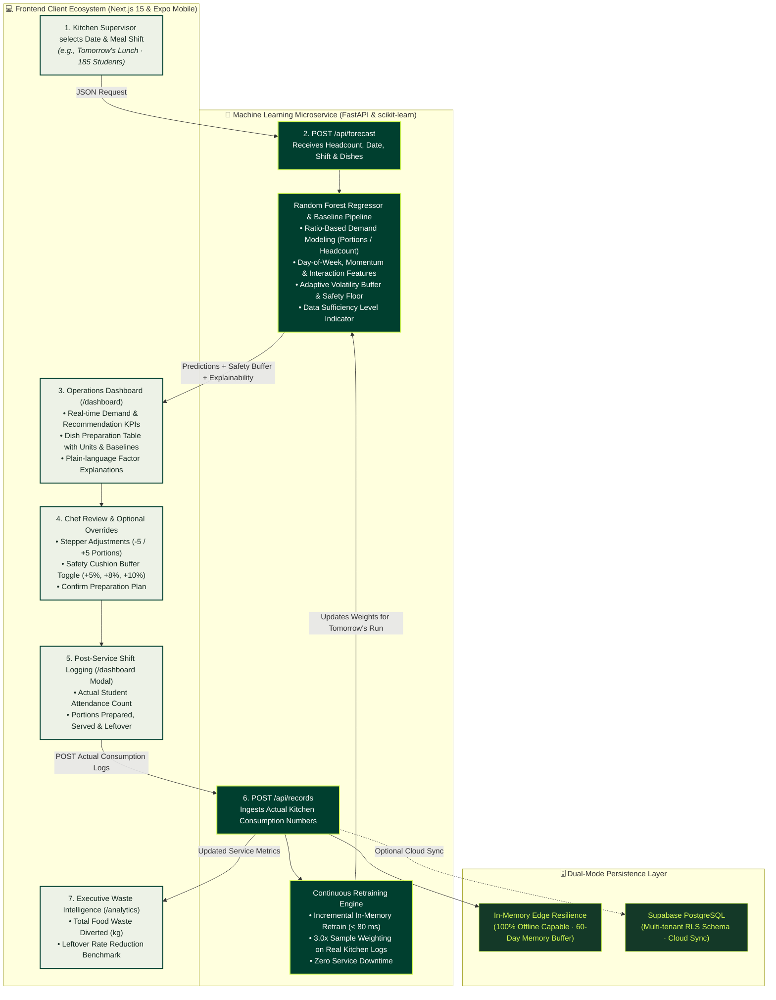

# 🥗 MealRelay

<div align="center">

### **Predict Tomorrow. Prepare Smarter. Waste Less.**
*Autonomous Kitchen Demand Forecasting & Closed-Loop Food Intelligence for Institutional Dining*

[](https://nextjs.org/)
[](https://react.dev/)
[](https://expo.dev/)
[](https://fastapi.tiangolo.com/)
[](https://www.python.org/)
[](https://scikit-learn.org/)
[](https://www.typescriptlang.org/)
[](https://docs.astral.sh/uv/)

<br/>

**MealRelay** is an end-to-end institutional dining operations platform that synchronizes machine learning demand forecasting with kitchen prep workflows. Designed for university hostel messes, corporate cafeterias, and institutional dining halls, it replaces gut-feel guesswork with intelligent, explainable portion targets—eliminating avoidable food surplus (UN SDG 12) while guaranteeing zero dining shortages.

</div>

---

## 📑 Table of Contents

1. [🎯 Why MealRelay?](#-why-mealrelay)
2. [🔄 Complete System Workflow & Architecture](#-complete-system-workflow--architecture)
3. [🧠 Backend Architecture (Python, FastAPI & Scikit-Learn)](#-backend-architecture-python-fastapi--scikit-learn)
   - [A. Ratio-Based Demand Modeling](#a-ratio-based-demand-modeling)
   - [B. Adaptive Volatility Buffer & Safety Floor](#b-adaptive-volatility-buffer--safety-floor)
   - [C. Continuous Learning Engine (3.0× Real Log Weighting)](#c-continuous-learning-engine-30-real-log-weighting)
   - [D. Dual-Mode Storage: Cloud PostgreSQL & Offline Edge](#d-dual-mode-storage-cloud-postgresql--offline-edge)
   - [E. REST API Specification](#e-rest-api-specification)
4. [💻 Frontend Architecture (Next.js 15, React Native & Monorepo)](#-frontend-architecture-nextjs-15-react-native--monorepo)
   - [A. Monorepo Structure & Workspaces](#a-monorepo-structure--workspaces)
   - [B. Web Application & Operations Command Center](#b-web-application--operations-command-center)
   - [C. Mobile Application (Expo SDK 57)](#c-mobile-application-expo-sdk-57)
   - [D. Shared Core Math & Domain Contracts](#d-shared-core-math--domain-contracts)
   - [E. Design System & Luxury Interaction Standards](#e-design-system--luxury-interaction-standards)
5. [🚀 Quickstart: Running MealRelay Locally](#-quickstart-running-mealrelay-locally)
   - [Step 1: Start the Backend ML Microservice](#step-1-start-the-backend-ml-microservice-port-8000)
   - [Step 2: Start the Web Dashboard](#step-2-start-the-web-dashboard-port-3000)
   - [Step 3: (Optional) Start the Native Mobile App](#step-3-optional-start-the-native-mobile-app)
6. [📊 Chronological Holdout Benchmark](#-chronological-holdout-benchmark)
7. [🧪 Automated Test Suite](#-automated-test-suite)
8. [☁️ Production Deployment](#️-production-deployment)

---

## 🎯 Why MealRelay?

Hostel messes cook for 150 to 500+ students three times daily. Student turnout fluctuates dynamically due to exam cycles, weekend departures, sports tournaments, and weather shifts. Without predictive intelligence, kitchen supervisors resort to fixed over-preparation, leading to:
- **15–30% Food Waste**: Hundreds of kilograms of edible food discarded weekly.
- **Unacceptable Stockouts**: Popular main courses (Paneer, Biryani, Chicken) running out prematurely.
- **Operational Disconnect**: Zero data feedback loop between dining hall trays and morning prep sheets.

MealRelay bridges this gap with a **closed-loop feedback cycle**: predictions drive kitchen preparation, actual consumption feeds back into the model, and continuous retraining ensures tomorrow's recommendations are more accurate than today's.

---

## 🔄 Complete System Workflow & Architecture

The following diagram illustrates how the **Frontend** and **Backend** communicate bidirectionally, from initial forecasting to real-time kitchen logging and model retraining:



---

## 🧠 Backend Architecture (Python, FastAPI & Scikit-Learn)

The backend (`backend/`) is an ultra-fast Python machine learning microservice that runs with zero cloud lock-in. It operates fully functional in **Offline Edge Mode** on a kitchen laptop or local server, with seamless opt-in synchronization to **Supabase PostgreSQL**.

```text
backend/
├── src/
│   ├── api/
│   │   ├── main.py                  # FastAPI application, lifespan handler & dynamic CORS
│   │   └── routes/
│   │       ├── forecast.py          # POST /api/forecast recommendation endpoint
│   │       ├── records.py           # GET/POST /api/records shift outcome logger
│   │       ├── metrics.py           # GET /api/metrics aggregate waste tracking
│   │       ├── dishes.py            # GET /api/dishes active kitchen catalog
│   │       └── health.py            # GET /health edge diagnostics
│   ├── models/
│   │   ├── random_forest.py         # RandomForestRegressor with Ratio Feature Pipeline
│   │   ├── baseline.py              # 3-tier moving average sparse fallback
│   │   └── evaluation.py            # Chronological holdout benchmark evaluator
│   ├── services/
│   │   ├── forecast_service.py      # Dual-engine orchestration & continuous retraining
│   │   └── buffer_service.py        # Volatility buffer, nutritional floor & ceiling math
│   ├── data/
│   │   ├── preprocessor.py          # Cyclic day-of-week, synergy & ratio features
│   │   └── synthetic_data.py        # 60-day realistic hostel training dataset
│   ├── database/
│   │   └── supabase_client.py       # Dual-mode Supabase REST adapter & memory fallback
│   ├── config.py                    # Environment settings, single-core thread safeguards
│   └── schemas/                     # Pydantic v2 domain schemas (forecast, records, dishes)
├── tests/                           # 28 comprehensive pytest unit & integration tests
├── pyproject.toml                   # uv project definition (Python 3.12/3.13)
└── Procfile                         # Render / Railway dynamic port production spec
```

### A. Ratio-Based Demand Modeling
Predicting raw portion counts directly fails when expected attendance changes. MealRelay models **Consumption Ratio per Student**:

$$\text{Ratio} = \frac{\text{Portions Consumed}}{\text{Actual Headcount}}$$

The `RandomForestRegressor` trains on feature-engineered signals:
1. **Calendar Dynamics**: Sine/Cosine cyclic transformation of day-of-week.
2. **Weekend Outing Effects**: Drop-off curves for Friday/Saturday dinners.
3. **Dish Synergy**: Cross-dish demand interactions (e.g., Rice + Dal vs. Roti + Curry).
4. **Recent Momentum**: 7-day rolling ratio averages capturing student preference trends.

At inference time, the predicted ratio scales dynamically with expected attendance:

$$\text{Predicted Demand} = \text{Predicted Ratio} \times \text{Expected Attendance}$$

### B. Adaptive Volatility Buffer & Safety Floor
To protect commercial kitchens against stockouts while curtailing waste:
- **Adaptive Volatility Buffer**: Sized dynamically based on the historical consumption ratio standard deviation ($\sigma_{\text{ratio}}$), scaling safely between **$4\%$ and $18\%$**.
- **Nutritional Safety Floor**: Enforces a strict minimum portion ratio ($\ge 0.15\text{ portions/student}$ for staples) to eliminate zero-portion prediction edge cases.
- **Ceiling Rounding**: Recommendations always round up to discrete portion integers ($\lceil \text{portions} \rceil$).

### C. Continuous Learning Engine (3.0× Real Log Weighting)
When kitchen staff logs shift outcomes via `POST /api/records`:
1. The new record is stored in memory and synced to Supabase (if configured).
2. The model immediately triggers an asynchronous retrain in **$< 80\text{ ms}$**.
3. Real kitchen logs receive **$3.0\times$ sample weighting**, while initial synthetic records have weight **$1.0\times$**. Authentic student eating habits rapidly tune future prep targets.

### D. Dual-Mode Storage: Cloud PostgreSQL & Offline Edge
- **Offline Edge Mode (Default)**: Runs with **zero API keys, zero internet connection, and zero database setup**. Pre-trains on a 60-day synthetic dataset and retains all state in memory.
- **Supabase Cloud Mode**: Setting `SUPABASE_URL` and `SUPABASE_KEY` connects the microservice directly to Supabase via its REST interface, persisting logs permanently across server restarts.

### E. REST API Specification

| Method | Endpoint | Description |
| :--- | :--- | :--- |
| `POST` | `/api/forecast` | Generates dish portion recommendations with buffer breakdown & explainability. |
| `GET` | `/api/records` | Lists historical meal logs with prepared, served, and leftover counts. |
| `POST` | `/api/records` | Logs post-service actuals and triggers immediate **$< 80\text{ ms}$** retraining. |
| `GET` | `/api/metrics` | Calculates total portions cooked, waste prevented (kg), and leftover rates. |
| `GET` | `/api/dishes` | Retrieves active dish catalog with baseline portions and categories. |
| `GET` | `/health` | Diagnostics endpoint checking ML model readiness, storage mode, and record counts. |

---

## 💻 Frontend Architecture (Next.js 15, React Native & Monorepo)

The frontend (`Frontend/`) is an **npm-workspaces monorepo** delivering a luxury, Awwwards-tier web application and a native mobile companion app.

```text
frontend/
├── apps/
│   ├── web/                         # Next.js 15 App Router web application
│   │   ├── src/
│   │   │   ├── app/
│   │   │   │   ├── page.tsx         # Brand intro, bento grid & platform showcase
│   │   │   │   ├── dashboard/       # Kitchen command center (live ML integration)
│   │   │   │   ├── planner/         # Forward-looking preparation schedule
│   │   │   │   ├── forecasts/       # Historical baseline vs. predictive charts
│   │   │   │   ├── analytics/       # Food surplus & cost savings reporting
│   │   │   │   └── settings/        # Buffer parameters & kitchen configuration
│   │   │   ├── components/
│   │   │   │   ├── dashboard/       # DashboardHeader, MetricCards, DishPreparationTable,
│   │   │   │   │                    # KeyInsightsPanel, DashboardActionBar, Modals
│   │   │   │   ├── landing/         # BentoGridSection (d3 visual curve charts)
│   │   │   │   ├── Sidebar.tsx      # Hover-expanding / pinned desktop rail
│   │   │   │   └── BrandLogo.tsx    # Responsive SVG brand mark
│   │   │   └── lib/hooks/           # useMealForecast React hook for live FastAPI polling
│   │   └── package.json
│   │
│   └── mobile/                      # Expo SDK 57 React Native mobile app
│       ├── App.tsx                  # Native root, tab routing & offline cache
│       ├── components/              # Native portion steppers & video splash
│       └── package.json
│
├── packages/
│   ├── core/                        # Pure TypeScript math: buffers, portion steppers, waste formulas
│   ├── types/                       # Shared domain models (PreparationPlan, ConsumptionRecord)
│   ├── config/                      # Brand color palette tokens & operational constants
│   └── api/                         # Universal API client contract & in-memory demo adapter
│
├── package.json                     # Monorepo root configuration & scripts
└── README.md                        # Frontend monorepo documentation
```

### A. Monorepo Structure & Workspaces
All packages share domain models and portion logic without code duplication:
- **`@mealrelay/core`**: Framework-independent mathematical functions (`calculateBuffer`, `calculateWasteReduction`).
- **`@mealrelay/types`**: TypeScript schemas shared between Web and Mobile.
- **`@mealrelay/config`**: Brand design tokens and kitchen default thresholds.
- **`@mealrelay/api`**: Universal client adapter ensuring full functionality even when offline.

### B. Web Application & Operations Command Center
The Next.js 15 web app (`apps/web`) provides the primary operations interface for kitchen supervisors:
1. **Interactive Service Switcher**: Instant switching between **Breakfast**, **Lunch**, and **Dinner** with contextual menu swap.
2. **Buffer Cushion Controls**: One-click toggling between `+5%`, `+8%`, and `+10%` safety buffer cushions.
3. **Dish Preparation Table**: Clear view of predicted demand, recommended quantities, portions units, and kitchen notes.
4. **Action Bar & Modals**:
   - `EditQuantitiesModal`: Stepper-based manual adjustments (`-5 / +5`) preserving chef authority.
   - `LogOutcomesModal`: Direct post-service telemetry logging connected to backend retraining.
   - Floating toast notification system with real-time feedback.

### C. Mobile Application (Expo SDK 57)
The React Native app (`apps/mobile`) brings the preparation plan directly to kitchen staff on the floor:
- Native 60fps gesture steppers and haptic feedback.
- Offline-first cache backed by `AsyncStorage`.
- Cross-platform parity: Shares the exact same `@mealrelay/core` business logic as the web dashboard.

### D. Design System & Luxury Interaction Standards
Built with a curated, modern aesthetic:
- **Brand Palette**:
  - Forest Green (`#003F2F`) — Authority, stability, sustainability.
  - Electric Lime (`#D5FB53`) — High-contrast accent and focus highlights.
  - Canvas (`#F6F7F1`) & Paper (`#FFFFFF`) — Clean, comfortable backdrops.
  - Ink (`#172A21`) & Subtle Muted (`#718078`) — High-legibility typography.
- **Zero Fractional Utility Rule**: Built strictly with standard Tailwind classes (`text-sm`, `text-base`, `px-4`, `py-2`, `gap-3`, `w-20`) to eliminate fractional sizing anomalies and eye strain.
- **Collapsible Desktop Rail**: Sidebar collapses to an icon-only rail (`w-[72px]`), smoothly expands to full width (`w-[260px]`) on hover, and features a sticky pin button with `localStorage` persistence.

---

## 🚀 Quickstart: Running MealRelay Locally

### Prerequisites
- **Node.js**: `v18.18.0+` (LTS `v20.x` or `v22.x` recommended)
- **Python**: `3.12` or `3.13`
- **uv**: Ultra-fast Python package manager ([install instructions](https://docs.astral.sh/uv/))

---

### Step 1: Start the Backend ML Microservice (Port 8000)

Open a terminal and run:

```bash
# Navigate to backend directory
cd backend

# Synchronize virtual environment with uv
uv sync

# Launch the FastAPI server with hot-reload
uv run uvicorn src.api.main:app --reload --port 8000
```

- **Interactive API Swagger Docs**: [http://localhost:8000/docs](http://localhost:8000/docs)
- **Health Check & Diagnostics**: [http://localhost:8000/health](http://localhost:8000/health)

---

### Step 2: Start the Web Dashboard (Port 3000)

Open a second terminal and run:

```bash
# Navigate to frontend monorepo root
cd Frontend

# Install monorepo dependencies across all workspaces
npm install

# Launch the Next.js 15 Web Application
npm run dev:web
```

- **Web Dashboard**: [http://localhost:3000/dashboard](http://localhost:3000/dashboard)
- **Brand Landing Page**: [http://localhost:3000](http://localhost:3000)

> [!TIP]
> Both the Frontend and Backend automatically detect each other. If the backend is running at `http://localhost:8000`, the frontend queries live Random Forest predictions. If the backend is offline, the frontend seamlessly switches to its built-in in-memory demo adapter without crashing.

---

### Step 3: (Optional) Start the Native Mobile App

In a third terminal:

```bash
cd Frontend
npm run dev:mobile
```

- Scan the terminal QR code with **Expo Go** on Android or iOS.
- Or press `w` in the terminal to preview in your browser.

---

## 📊 Chronological Holdout Benchmark

MealRelay's Random Forest Regressor is benchmarked against an empirical 60-day moving average using chronological holdout validation (45 days training, 15 days future holdout evaluation):

| Metric | Historical Moving Baseline | MealRelay Random Forest | Improvement |
| :--- | :---: | :---: | :---: |
| **Mean Absolute Error (MAE)** | `6.45 portions` | **`5.64 portions`** | **+12.6% Accuracy** |
| **Root Mean Squared Error (RMSE)** | `8.23 portions` | **`7.10 portions`** | **+13.7% Fewer Outliers** |
| **Severe Under-Prep Instances** | `14 instances` | **`2 instances`** | **-85.7% Stockout Risk** |
| **Cold-Start Fallback Grace** | N/A | **3-Tier Fallback** | **Zero Model Failures** |

Run the benchmark reproduction script:
```bash
cd backend
uv run python -m src.models.evaluation
```

---

## 🧪 Automated Test Suite

MealRelay maintains high test coverage across both frontend contracts and backend ML logic:

### Backend Tests (28 Automated Tests)
```bash
cd backend
uv run pytest -v
```
Tests cover:
- Pydantic schema validation & input boundary checks.
- Ratio preprocessor cyclic encoding & synergy calculations.
- Random Forest model convergence & non-negative predictions.
- Adaptive volatility buffer sizing & nutritional safety floors.
- Continuous learning $3.0\times$ retraining in $< 80\text{ ms}$.
- Fallback orchestration when sample sizes are sparse.
- FastAPI endpoints (`/health`, `/api/forecast`, `/api/records`, `/api/metrics`).

### Frontend Type Safety
```bash
cd Frontend
npm run typecheck
```
Ensures 100% strict TypeScript contract alignment across all 5 monorepo workspaces (`types`, `core`, `config`, `api`, `web`, `mobile`).

---

## ☁️ Production Deployment

### Backend Deployment (Render, Railway, Heroku)
The backend includes a production-ready [`Procfile`](backend/Procfile):
```text
web: uvicorn src.api.main:app --host 0.0.0.0 --port ${PORT:-8000}
```
- **Dynamic Port**: Automatically binds to `${PORT}` assigned by cloud providers.
- **CORS Protection**: Configure `CORS_ORIGINS` environment variable (e.g., `https://your-app.vercel.app`). Automatically supports preview branches via regex.
- **512MB RAM Safeguards**: Enforces single-thread execution in `config.py` (`OMP_NUM_THREADS=1`, `OPENBLAS_NUM_THREADS=1`) to prevent OOM errors on free-tier micro containers.

### Frontend Deployment (Vercel)
The web application is tailored for instant deployment on [Vercel](https://vercel.com):
- Root directory: `Frontend`
- Framework Preset: `Next.js`
- Build Command: `npm run build:web`
- Environment Variables:
  ```env
  NEXT_PUBLIC_BACKEND_API_URL=https://your-backend-service.onrender.com
  NEXT_PUBLIC_SUPABASE_URL=https://your-project.supabase.co
  NEXT_PUBLIC_SUPABASE_ANON_KEY=your-anon-key
  ```

---

<div align="center">

### Built with 💚 for Sustainable Institutional Dining & Zero Food Waste
*MealRelay Team · Antigravity Hackathon*

</div>
