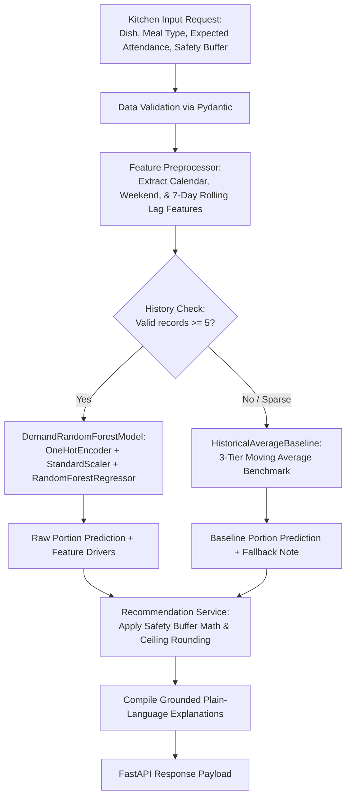

# 🧠 MealRelay — Backend AI Model & API

> **Predict Tomorrow. Prepare Smarter. Waste Less.**  
> High-performance Python machine learning microservice and REST API that forecasts next-day dish portion demand for hostel messes and commercial kitchens, recommending preparation quantities with a configurable safety buffer to eliminate avoidable food waste.

---

## 📑 Table of Contents

1. [🎯 What Is Actually Accomplished](#1--what-is-actually-accomplished)
2. [📥 Inputs & 📤 Outputs (Specification & Payloads)](#2--inputs---outputs-specification--payloads)
3. [🏗️ Architectural Design & Module Walkthrough](#3-️-architectural-design--module-walkthrough)
4. [⚙️ How It Works: The 5-Stage Machine Learning Pipeline](#4-️-how-it-works-the-5-stage-machine-learning-pipeline)
5. [📊 Benchmark Evaluation & Results](#5--benchmark-evaluation--results)
6. [🛡️ Safety Buffer & Transparent Fallback Strategy](#6-️-safety-buffer--transparent-fallback-strategy)
7. [🚀 API Reference](#7--api-reference)
8. [💻 Developer Quickstart (`uv`)](#8--developer-quickstart-uv)
9. [🧪 Automated Test Suite](#9--automated-test-suite)

---

## 1. 🎯 What Is Actually Accomplished

Hostel messes cook for 150–300 students three times a day. Because attendance fluctuates drastically (weekend sleep-ins, Friday dinner outings, exam schedules), kitchen supervisors typically guess preparation quantities based on rough intuition. This produces two persistent failures:
- **Avoidable Food Waste**: Preparing 15–30% too much food that spoils and is discarded at the end of the shift.
- **Critical Shortages**: Under-cooking high-demand dishes (e.g. Biryani, Paneer, Chicken), forcing cooks to scramble or students to go hungry.

### Key Capabilities Built & Delivered:
1. **Accurate Machine Learning Forecasting**:
   A tuned `RandomForestRegressor` pipeline captures multi-factor interactions between food categories, day-of-week attendance patterns, expected headcounts, and recent 7-day rolling consumption trends.
2. **Benchmark Improvement Over Historical Average**:
   In chronological holdout testing across unseen future dates, the Random Forest model achieves a **Mean Absolute Error (MAE) of 5.64 portions vs. 6.45 portions for the historical average**, delivering a **+12.6% accuracy improvement**.
3. **No Fabricated Confidence (Transparent Sparse-Data Fallback)**:
   When a new dish or menu item has fewer than 5 historical logs (`MIN_DATA_THRESHOLD`), the model refuses to hallucinate predictions. Instead, it transparently falls back to a multi-tier moving average baseline and explicitly notifies the supervisor.
4. **Kitchen Safety Buffer ($+10\%$ Default)**:
   Applies ceiling-rounded safety margins ($\lceil \text{Prediction} \times (1 + \text{buffer}) \rceil$) to prevent shortages while eliminating excessive over-preparation.
5. **Grounded Explainability**:
   Every recommendation is accompanied by human-readable operational drivers explaining *why* a number was suggested (e.g., student turnout ratio, weekend dip, or 7-day momentum).
6. **Explicit Null Handling**:
   Untracked historical meals (`served_portions = null`) are preserved as explicit nulls and filtered safely—never falsely cast to 0.

---

## 2. 📥 Inputs & 📤 Outputs (Specification & Payloads)

### A. Forecasting API (`POST /api/forecast`)

#### Input Payload (`ForecastRequest`)
The kitchen manager sends the target service date, meal type, expected headcount, safety buffer, and list of planned dishes:

```json
{
  "meal_date": "2026-10-22",
  "meal_type": "lunch",
  "expected_attendance": 185,
  "safety_buffer_pct": 0.10,
  "dishes": [
    {
      "dish_id": "d_rice_lunch",
      "dish_name": "Steamed Basmati Rice"
    },
    {
      "dish_id": "d_paneer_lunch",
      "dish_name": "Paneer Butter Masala"
    },
    {
      "dish_id": "d_fusion_curry",
      "dish_name": "New Fusion Curry"
    }
  ]
}
```

| Input Field | Type | Description |
| :--- | :--- | :--- |
| `meal_date` | `string (YYYY-MM-DD)` | Target date for the meal service. |
| `meal_type` | `string` | `"breakfast"`, `"lunch"`, or `"dinner"`. |
| `expected_attendance` | `integer` | Projected student headcount (e.g. 185). |
| `safety_buffer_pct` | `float (optional)` | Safety margin multiplier (e.g. `0.10` for +10%). Defaults to system config if omitted. |
| `dishes` | `array of objects` | Planned menu items (`dish_id`, `dish_name`). |

---

#### Output Payload (`ForecastResponse`)
The service returns per-dish portion predictions, recommended cooking counts, model attribution, and explainability factors:

```json
{
  "meal_date": "2026-10-22",
  "meal_type": "lunch",
  "expected_attendance": 185,
  "safety_buffer_pct": 0.10,
  "total_recommended_portions": 472,
  "generated_at": "2026-10-16T15:10:00Z",
  "recommendations": [
    {
      "dish_id": "d_rice_lunch",
      "dish_name": "Steamed Basmati Rice",
      "meal_type": "lunch",
      "predicted_portions": 178.4,
      "safety_buffer_pct": 0.10,
      "recommended_portions": 197,
      "model_used": "random_forest",
      "data_points_count": 60,
      "is_fallback": false,
      "explanation_factors": [
        "Expected attendance of 185 students with modeled Steamed Basmati Rice consumption ratio of ~0.96x.",
        "Aligned with typical weekday Thursday dining attendance curve.",
        "Consistent with 7-day rolling average consumption (176.8 portions).",
        "+10% safety buffer applied (+18 extra portions) to prevent food shortage."
      ]
    },
    {
      "dish_id": "d_paneer_lunch",
      "dish_name": "Paneer Butter Masala",
      "meal_type": "lunch",
      "predicted_portions": 162.1,
      "safety_buffer_pct": 0.10,
      "recommended_portions": 179,
      "model_used": "random_forest",
      "data_points_count": 60,
      "is_fallback": false,
      "explanation_factors": [
        "Expected attendance of 185 students with modeled Paneer Butter Masala consumption ratio of ~0.88x.",
        "Aligned with typical weekday Thursday dining attendance curve.",
        "+10% safety buffer applied (+16 extra portions) to prevent food shortage."
      ]
    },
    {
      "dish_id": "d_fusion_curry",
      "dish_name": "New Fusion Curry",
      "meal_type": "lunch",
      "predicted_portions": 86.4,
      "safety_buffer_pct": 0.10,
      "recommended_portions": 96,
      "model_used": "baseline_fallback",
      "data_points_count": 0,
      "is_fallback": true,
      "explanation_factors": [
        "Limited historical data (0 records): transparent baseline average used instead of ML.",
        "No prior history for this dish; fallback estimate at 90% of expected attendance (86.4 portions).",
        "+10% safety buffer applied (+9 extra portions) to prevent food shortage."
      ]
    }
  ]
}
```

---

### B. Historical Meal Record Logging (`POST /api/records`)

#### Input Payload (`MealRecordCreate`)
Used by supervisors at the end of a meal session to log actual operational outcomes:

```json
{
  "dish_id": "d_rice_lunch",
  "dish_name": "Steamed Basmati Rice",
  "meal_date": "2026-10-21",
  "meal_type": "lunch",
  "attendance": 182,
  "prepared_portions": 195,
  "served_portions": 178,
  "leftover_portions": 17
}
```

| Input Field | Type | Description |
| :--- | :--- | :--- |
| `dish_id` | `string` | Unique identifier of the dish. |
| `meal_date` | `string (YYYY-MM-DD)` | Date of the completed meal session. |
| `meal_type` | `string` | `"breakfast"`, `"lunch"`, or `"dinner"`. |
| `attendance` | `integer (optional)` | Observed headcount during the session. |
| `prepared_portions` | `integer` | Quantity cooked/prepared. |
| `served_portions` | `integer (optional)` | Portions actually consumed. Preserved as `null` if unmeasured. |
| `leftover_portions` | `integer (optional)` | Portions remaining uneaten at shift end. |

---

## 3. 🏗️ Architectural Design & Module Walkthrough

The backend is organized into distinct, single-responsibility modules:

```text
backend/
├── pyproject.toml              # Project dependencies, packaging, and pytest configuration
├── uv.lock                     # Locked dependencies (scikit-learn, pandas, numpy, fastapi, uvicorn)
├── .python-version             # Python 3.13 pin
├── .gitignore                  # Strict exclusions (.venv, __pycache__, .pytest_cache)
│
├── src/                        # Core backend Python source package
│   ├── __init__.py
│   ├── config.py               # Constants: DEFAULT_SAFETY_BUFFER (10%), MIN_DATA_THRESHOLD (5)
│   │
│   ├── schemas/                # Layer 1: Data Contracts & Type Validation
│   │   ├── __init__.py         # Exports schemas
│   │   ├── dish.py             # Dish models, categories (Main, Curry, Rice, Bread, Side, Dessert)
│   │   ├── meal_record.py      # MealRecord schema with explicit null preservation
│   │   └── forecast.py         # Request and response models for next-day recommendations
│   │
│   ├── data/                   # Layer 2: Data Generation & Preprocessing
│   │   ├── __init__.py
│   │   ├── synthetic.py        # 60-day synthetic mess generator (200 capacity, weekend drop, Friday peak)
│   │   └── preprocessor.py     # 7-day rolling lagged demand, turnout ratios, calendar features
│   │
│   ├── models/                 # Layer 3: Machine Learning & Statistical Benchmark
│   │   ├── __init__.py
│   │   ├── baseline.py         # HistoricalAverageBaseline moving benchmark & 3-tier fallback
│   │   ├── random_forest.py    # DemandRandomForestModel with ColumnTransformer pipeline
│   │   └── evaluation.py       # Chronological holdout validation (MAE, RMSE, bias metrics)
│   │
│   ├── services/               # Layer 4: Business Logic & Orchestration
│   │   ├── __init__.py
│   │   ├── recommendation.py   # Safety buffer math: Recommended = ceil(pred * (1 + buffer))
│   │   └── forecast_service.py # Routing logic: sufficiency check -> RF inference or baseline fallback
│   │
│   └── api/                    # Layer 5: REST API Delivery (FastAPI)
│       ├── __init__.py
│       ├── main.py             # FastAPI entrypoint, CORS configuration, health check
│       └── routes/
│           ├── __init__.py
│           ├── forecast.py     # POST /api/forecast, GET /api/metrics
│           └── records.py      # GET/POST /api/records, GET /api/dishes, POST /api/records/reset-synthetic
│
└── tests/                      # Automated Unit & Integration Tests (22 Tests)
    ├── __init__.py
    ├── test_baseline.py        # 4 unit tests: moving averages, fallbacks, ratio estimation
    ├── test_random_forest.py   # 5 unit tests: pipeline fitting, importances, explainability
    ├── test_evaluation.py      # 1 unit test: chronological validation report
    ├── test_services.py        # 4 unit tests: buffer precision, orchestration routing
    └── test_api.py             # 8 integration tests: FastAPI endpoints, status codes, payload validation
```

---

## 4. ⚙️ How It Works: The 5-Stage Machine Learning Pipeline



### Stage 1: Feature Engineering (`src/data/preprocessor.py`)
Features extracted for each prediction:
1. `dish_id` *(categorical)*: Specific recipe identity.
2. `meal_type` *(categorical)*: Breakfast, Lunch, or Dinner.
3. `day_of_week` *(integer 0–6)*: Monday through Sunday.
4. `expected_attendance` *(integer)*: Projected turnout for the session.
5. `is_holiday_or_weekend` *(binary 0/1)*: Identifies weekend dining dips.
6. `lagged_avg_demand_7d` *(float)*: Shifted 7-day rolling average of actual consumption (preventing future lookahead leakage).

### Stage 2: Dual Forecasting Engine (`src/models/`)
- **Random Forest Model**:
  - `ColumnTransformer` with `OneHotEncoder(handle_unknown="ignore")` and `StandardScaler()`.
  - `RandomForestRegressor(n_estimators=100, max_depth=12, min_samples_split=4)`.
  - Enforces positive portion bounds: $\hat{y} = \max(0, \hat{y}_{\text{raw}})$.
- **Historical Average Baseline**:
  - Computes historical consumption averages for `(dish_id, day_of_week)` to serve as the empirical comparator.

### Stage 3: Transparent Routing (`src/services/forecast_service.py`)
- If historical observations $\ge 5$: calls Random Forest for non-linear prediction and feature attribution.
- If historical observations $< 5$: calls Baseline Fallback and flags `is_fallback = true`.

### Stage 4: Safety Buffer Application (`src/services/recommendation.py`)
To prevent shortages, a configurable safety buffer (default $+10\%$) is applied using ceiling rounding:
$$\text{Recommended Portions} = \left\lceil \text{round}\Big(\hat{y} \times (1 + \text{buffer}), 6\Big) \right\rceil$$

### Stage 5: Grounded Factor Explainability
Builds structured operational explanations:
1. Turnout factor: expected student headcount and consumption factor.
2. Calendar factor: typical weekday pattern vs. weekend dip vs. Friday dinner special.
3. Rolling trend: comparison against recent 7-day demand momentum.
4. Buffer breakdown: extra portions cooked to ensure zero stockouts.

---

## 5. 📊 Benchmark Evaluation & Results

The system includes a dedicated chronological holdout validation script (`src/models/evaluation.py`):

```bash
uv run python -m src.models.evaluation
```

### Evaluation Methodology:
- **Chronological Split**: First 45 days (617 portions) used for training; last 15 days (198 portions) held out as unseen future test data.
- **Leakage Prevention**: Future dates are never shuffled into past training sets.

### Holdout Benchmark Results:
```text
==============================================================================
MEALRELAY — FORECAST MODEL BENCHMARK EVALUATION
==============================================================================
Data Partition: Chronological Holdout (Train: 45 days, Test: 15 days)
Observations:   Train: 617 portions, Test: 198 portions
Dataset Status: SYNTHETIC HOSTEL MESS DATA (is_synthetic = True)
------------------------------------------------------------------------------
Metric                           | Random Forest      | Historical Average
------------------------------------------------------------------------------
Mean Absolute Error (MAE)        | 5.64 portions      | 6.45 portions     
Root Mean Squared Error (RMSE)   | 6.87 portions      | 7.98 portions     
Over-Prediction Rate (%)         | 51.5%              | 41.9%             
Under-Prediction Rate (%)        | 43.4%              | 55.1%             
Mean Directional Bias (portions) | +0.41 portions     | -0.88 portions    
------------------------------------------------------------------------------
MAE Improvement over Baseline:   +12.6%
------------------------------------------------------------------------------
NOTE: Evaluation performed on synthetic hostel mess data. Illustrative benchmark only;
real-world accuracy depends on kitchen logging consistency.
==============================================================================
```

---

## 6. 🛡️ Safety Buffer & Transparent Fallback Strategy

### 3-Tier Hierarchical Fallback (When Data Is Sparse):
1. **Tier 1 (Day-of-Week Average)**:
   Used when $\ge 2$ historical sessions exist for that dish on that specific day of the week (capturing Friday peaks or Sunday drops).
2. **Tier 2 (Overall Dish Average)**:
   Used when weekday data is sparse, taking the mean of all past servings for that dish.
3. **Tier 3 (Attendance Ratio Estimation)**:
   Used for brand new dishes with 0 prior history, estimating demand as a standard percentage of expected attendance (e.g. $90\%$).

At all times, `is_fallback: true` is sent to the UI with a clear alert:
> *"Limited historical data (2 records): transparent baseline average used instead of ML."*

---

## 7. 🚀 API Reference

Base URL: `http://localhost:8000`  
Interactive OpenAPI Documentation: `http://localhost:8000/docs`

| Method | Endpoint | Description |
| :--- | :--- | :--- |
| `GET` | `/health` | Service health, model readiness, and dataset size. |
| `POST` | `/api/forecast` | Generates next-day demand forecasts and portion recommendations. |
| `GET` | `/api/metrics` | Model benchmark evaluation report (Random Forest vs Baseline). |
| `GET` | `/api/records` | Query historical meal logs with filters (`dish_id`, `meal_type`, date range). |
| `POST` | `/api/records` | Log actual prepared, served, and leftover quantities for a meal. |
| `POST` | `/api/records/reset-synthetic` | Reset and retrain models on the standard 60-day synthetic dataset. |
| `GET` | `/api/dishes` | Returns the canonical catalog of mess dishes. |

---

## 8. 💻 Developer Quickstart (`uv`)

### 1. Prerequisites
Ensure `uv` is installed:
```bash
uv --version
```

### 2. Install & Sync Dependencies
```bash
cd backend
uv sync
```

### 3. Run the Unit & Integration Test Suite
```bash
uv run pytest
```

### 4. Run Model Benchmark Evaluation
```bash
uv run python -m src.models.evaluation
```

### 5. Start the FastAPI Development Server
```bash
uv run uvicorn src.api.main:app --reload --port 8000
```
Open `http://localhost:8000/docs` in your browser.

---

## 9. 🧪 Automated Test Suite

The test suite covers 22 automated unit and integration tests across 5 test modules:

```text
============================= test session starts =============================
plugins: anyio-4.15.1
collected 22 items

tests/test_api.py ........                                               [ 36%]
tests/test_baseline.py ....                                              [ 54%]
tests/test_evaluation.py .                                               [ 59%]
tests/test_random_forest.py .....                                        [ 81%]
tests/test_services.py ....                                              [100%]

============================= 22 passed in 2.70s ==============================
```

- **`test_baseline.py`**: Validates moving average accuracy, multi-tier fallback levels, ratio estimates, and DataFrame predictions.
- **`test_random_forest.py`**: Validates pipeline fitting, feature importances, non-negative bounds, factor explanations, and unseen category handling.
- **`test_evaluation.py`**: Validates chronological holdout data partitioning, metrics computation, and synthetic labeling.
- **`test_services.py`**: Validates floating-point ceiling buffer math, fallback flag generation, and orchestration routing.
- **`test_api.py`**: Validates HTTP status codes, request schemas, validation error handling, and end-to-end integration across all endpoints.
