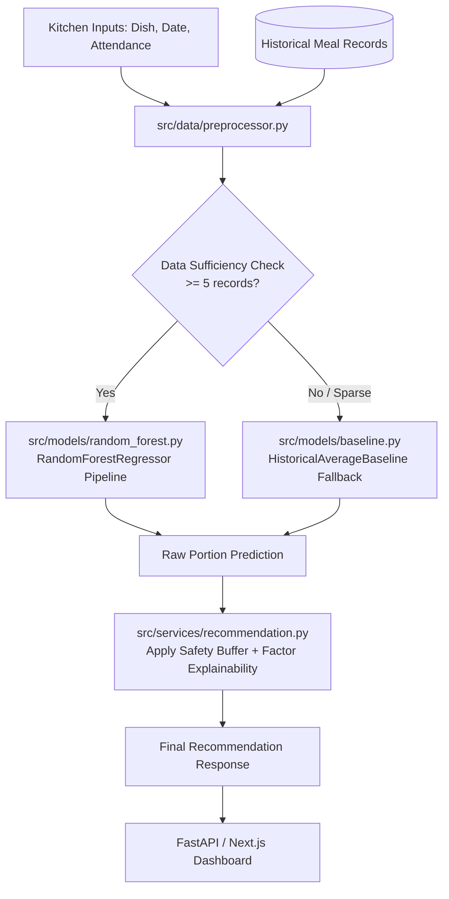

# MealRelay — Backend Service & ML Pipeline

The backend service for **MealRelay**, an AI-assisted meal planning and demand forecasting engine designed for hostel kitchens and mess supervisors. Its primary purpose is to forecast next-day food portion demand per dish and recommend safe preparation quantities to minimize food waste while preventing kitchen shortages.

---

## 1. Architectural Philosophy

The backend adheres to a strictly **modular, layered architecture** with clear separation of concerns (no monolithic scripts):

- **Data Contracts (`schemas/`)**: Pure Pydantic models enforcing type safety, validation, and explicit handling of missing values (e.g., untracked meal portions are never silently cast to 0).
- **Data Engineering (`data/`)**: Synthetic mess data generation and feature extraction (rolling averages, attendance signals, calendar patterns).
- **Forecasting Models (`models/`)**: Dual-engine forecasting combining a non-linear machine learning model (`RandomForestRegressor`) with an empirical moving-average benchmark (`HistoricalAverageBaseline`).
- **Business Logic & Recommendations (`services/`)**: Configurable safety buffer scaling, portion ceiling rounding, and plain-language factor explainability.
- **Web API Layer (`api/`)**: FastAPI application exposing high-throughput REST endpoints to the Next.js frontend.
- **Automated Tests (`tests/`)**: Pytest test suite covering statistical calculations, machine learning pipelines, and edge cases.

---

## 2. Directory Structure Walkthrough

```text
backend/
├── PLAN.md                     # Roadmap, architecture guidelines, and step-by-step checklist
├── README.md                   # This architectural and developer guide
├── pyproject.toml              # Python project configuration and dependencies managed by uv
├── uv.lock                     # Deterministic dependency lockfile
├── .python-version             # Python version pin (3.13)
├── .gitignore                  # Backend-specific ignore rules (virtualenvs, cache files)
│
├── src/                        # Core backend Python source package
│   ├── __init__.py
│   ├── config.py               # Central configuration, hyperparameters, defaults (10% safety buffer)
│   │
│   ├── schemas/                # Pydantic data schemas & contracts
│   │   ├── __init__.py         # Exports all data models
│   │   ├── dish.py             # Dish representation, categories (Main, Curry, Rice, etc.), meal types
│   │   ├── meal_record.py      # Historical records (prepared, served, leftovers, attendance)
│   │   └── forecast.py         # Request and response models for next-day recommendations
│   │
│   ├── data/                   # Data generation and feature engineering
│   │   ├── __init__.py
│   │   ├── synthetic.py        # 60-day synthetic dataset generator for a 200-student hostel mess
│   │   └── preprocessor.py     # Feature extraction (rolling 7-day lagged demand, weekday flags)
│   │
│   ├── models/                 # Forecasting models and evaluation
│   │   ├── __init__.py
│   │   ├── baseline.py         # Historical-average moving baseline & multi-tier sparse data fallback
│   │   ├── random_forest.py    # Scikit-learn RandomForestRegressor with ColumnTransformer pipeline
│   │   └── evaluation.py       # Chronological holdout validation & benchmark comparison (MAE, bias)
│   │
│   ├── services/               # Orchestration & business logic
│   │   ├── __init__.py
│   │   ├── recommendation.py   # Safety buffer calculation (Recommended = ceil(pred * (1 + buffer)))
│   │   └── forecast_service.py # Routing logic: sufficiency check -> RF inference or baseline fallback
│   │
│   └── api/                    # Web delivery layer (FastAPI)
│       ├── __init__.py
│       ├── main.py             # FastAPI entrypoint, CORS middleware, and health check
│       └── routes/
│           ├── __init__.py
│           ├── forecast.py     # POST /api/forecast (next-day portion recommendation endpoint)
│           └── records.py      # GET/POST /api/records (historical meal tracking endpoint)
│
└── tests/                      # Automated unit and regression test suite
    ├── __init__.py
    ├── test_baseline.py        # Tests for moving average, sparse fallback, and ratio estimation
    └── test_random_forest.py   # Tests for pipeline training, feature importances, and explainability
```

---

## 3. How the Backend Works (Data Flow)



### 1. Data Ingestion & Contracts (`src/schemas/`)
- `MealRecord`: Models actual historical kitchen sessions. Crucially, `served_portions: Optional[int]` allows explicit nulls when a mess supervisor did not measure leftovers. The system never blindly casts missing data to `0`.
- `Dish`: Classifies dishes into food types (`rice`, `bread`, `curry`, `main`, `dessert`) and meal sessions (`breakfast`, `lunch`, `dinner`).
- `ForecastRequest` & `ForecastResponse`: Clean API payload contracts defining requested dishes, attendance, safety buffer, and returning portions with factor explainability.

### 2. Feature Engineering (`src/data/`)
- **`synthetic.py`**: Simulates realistic hostel mess dynamics across 60 days for 200 students:
  - Weekend breakfast attendance drops (~55% turnout).
  - Weekday lunch & dinner turnout (~85-92% turnout).
  - Friday dinner special surge (~96% turnout).
  - Food category consumption factors (e.g., higher portion ratio for rice and bread vs. sides).
  - All synthetic records are explicitly tagged `is_synthetic = True`.
- **`preprocessor.py`**:
  - Computes `lagged_avg_demand_7d` using a shifted rolling window to prevent future data leakage.
  - Generates calendar signals: `day_of_week` and `is_holiday_or_weekend`.
  - Maps categorical identifiers for one-hot encoding.

### 3. Dual Forecasting Engine (`src/models/`)
- **`DemandRandomForestModel`**:
  - Uses `sklearn.pipeline.Pipeline` combining a `ColumnTransformer` (One-Hot Encoding for categorical features and `StandardScaler` for continuous features) with a `RandomForestRegressor`.
  - Captures non-linear feature interactions (e.g., student turnout + Friday dinner special + recent 7-day trend).
  - Generates **grounded factor explanations** explaining *why* the portion was predicted.
- **`HistoricalAverageBaseline`**:
  - Moving-average benchmark that calculates mean demand per `(dish_id, day_of_week)`.
  - Implements a **3-tier fallback**:
    - *Tier 1*: Specific day-of-week average (if $\ge 2$ historical samples exist).
    - *Tier 2*: Overall dish average across all days (if overall $\ge 1$ sample exists).
    - *Tier 3*: Capacity ratio estimate (if 0 prior records exist).
  - Transparently flags `is_sparse = True` to prevent false confidence when history is thin.

### 4. Recommendation & Explainability (`src/services/`)
- Takes the raw predicted portions from the model.
- Applies the supervisor-configured safety buffer:
  $$\text{Recommended Portions} = \left\lceil \text{Predicted Portions} \times (1 + \text{buffer}) \right\rceil$$
- Formats plain-language factors (e.g., *"Expected attendance of 185 (+15 vs typical weekday) drives higher demand (+10% safety buffer: 182 portions)"*).

### 5. API Delivery Layer (`src/api/`)
- Built with **FastAPI** for high performance and automatic OpenAPI documentation.
- CORS configured for seamless integration with the Next.js frontend.

---

## 4. Developer Quickstart with `uv`

All dependencies and virtual environments are managed using [`uv`](https://github.com/astral-sh/uv).

### 1. Install & Sync Dependencies
```bash
# Navigate to the backend directory
cd backend

# Synchronize all packages and virtual environment
uv sync
```

### 2. Run the Unit Test Suite
```bash
# Execute all tests across baseline and random forest models
uv run pytest
```

### 3. Run Standalone Model Evaluation
```bash
# Execute chronological holdout benchmark (Random Forest vs Baseline)
uv run python -m src.models.evaluation
```

### 4. Launch the FastAPI Development Server
```bash
# Start FastAPI on port 8000 with auto-reload
uv run uvicorn src.api.main:app --reload --port 8000
```
Interactive API docs will be available at: `http://localhost:8000/docs`.
